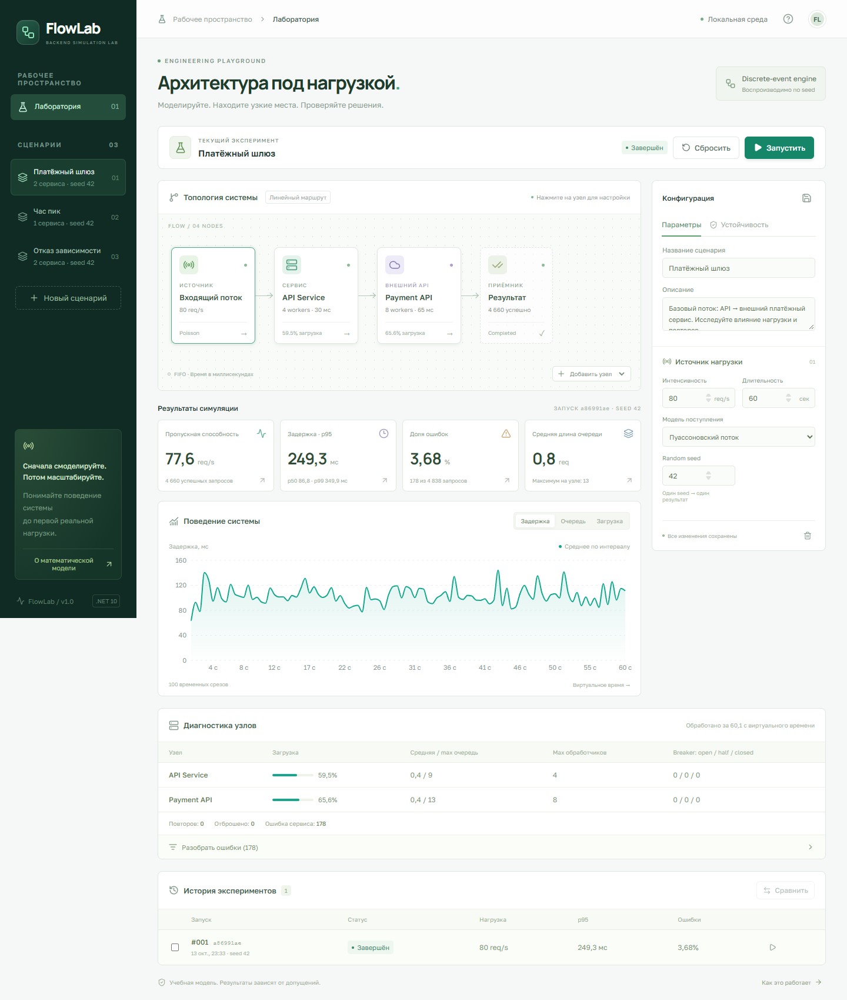

# FlowLab

**Визуальная лаборатория производительности и отказоустойчивости backend-систем.**

React 19 + TypeScript · ASP.NET Core / .NET 10 · PostgreSQL 16 · EF Core 10 · SignalR.

Задайте нагрузку, соберите последовательные и параллельные этапы, запустите воспроизводимую дискретно-событийную симуляцию и сравните результаты. FlowLab показывает влияние ограниченной параллельности, FIFO/LIFO очередей, отказов зависимости, повторов и circuit breaker. Вкладка «Инструкция и примеры» содержит описание настроек, метрик и экспериментов.

Рабочие пространства создаются, переименовываются и удаляются в боковой панели. Каждое содержит свои сценарии. Корзина возле сценария удаляет его вместе с историей запусков; удаление пространства удаляет все его сценарии и запуски. Оба действия требуют подтверждения в popup. Активные запуски блокируют удаление. Пространства хранятся в PostgreSQL; миграция `AddWorkspaces` относит существующие сценарии к пространству «Лаборатория». Демонстрационные сценарии создаются только при первой инициализации базы и не восстанавливаются после удаления.

### Графы API и очереди сообщений

Нажмите **«Редактировать связи»** над топологией, чтобы преобразовать существующие этапы в граф. Добавляйте и удаляйте явные связи через поля «Откуда» и «Куда». Порядок узлов в массиве больше не задаёт маршрут. Ветви выполняются независимо, общий потомок запускается один раз после завершения всех активных предшественников. Источник и сервисы поддерживают рассылку во все исходящие ветви либо выбор одной ветви по кругу. Схема должна быть достижима от источника и не содержать циклов; максимум 512 связей.

Готовые примеры **«Два API параллельно»** и **«RabbitMQ + 3 консьюмера»** заменяют схему в редакторе. Брокер содержит общую ограниченную FIFO/LIFO очередь и выдаёт каждое сообщение одному свободному консьюмеру по кругу. Обработчики консьюмера ограничивают число одновременных доставок; занятые консьюмеры пропускаются. Консьюмер брокера не может иметь другие входящие связи. Для рассылки каждому подписчику используйте несколько брокеров, представляющих отдельные очереди. В диагностике показаны число начатых вызовов / доставок, очередь брокера и загрузка консьюмеров.

Модель измеряет обработку задания до конца, включая ожидание в брокере. Это не отдельная задержка HTTP-ответа издателя. Таймауты и повторы относятся ко всему маршруту; durable storage, publisher confirms, nack/requeue, DLQ и восстановление брокера пока не моделируются. Старые сценарии без `connections` продолжают выполняться в режиме этапов; JSON-хранилище поддерживает новый граф без миграции БД.

> Интерфейс реализован на **React** по прямому указанию заказчика, вместо Blazor из исходного ТЗ. Это учебная модель, а не точный прогноз production-системы.



## Быстрый локальный запуск

Нужны .NET SDK 10, Node.js 22.12+ и PostgreSQL на `localhost:5432`. В этой среде проверено подключение `postgres` / `postgres`; эти публичные локальные учётные данные нельзя использовать в production.

Из корня в PowerShell:

```powershell
./start.ps1
```

Скрипт устанавливает frontend-зависимости при необходимости, собирает React, запускает приложение в Development и задаёт локальную строку подключения, если переменная ещё не установлена. Откройте **http://localhost:5080**. Повторный запуск без пересборки интерфейса: `./start.ps1 -SkipFrontend`.

Приложение автоматически применяет EF migrations. Если базы `flowlab` ещё нет, пользователь PostgreSQL должен иметь право создавать базы; иначе создайте её заранее:

```powershell
# psql должен находиться в PATH; на Windows он обычно в C:/Program Files/PostgreSQL/16/bin.
$env:PGPASSWORD = 'postgres'
psql -h localhost -U postgres -d postgres -c 'CREATE DATABASE flowlab;'
Remove-Item Env:PGPASSWORD
```

Существующую базу создавать повторно не нужно. Пароли и настройки уже работающего PostgreSQL приложение не меняет.

### Ручной запуск и миграции

```powershell
cd frontend
npm ci
npm run build
cd ..

$env:ASPNETCORE_ENVIRONMENT = 'Development'
$env:ConnectionStrings__FlowLab = 'Host=localhost;Port=5432;Database=flowlab;Username=postgres;Password=postgres'
dotnet tool restore
dotnet ef database update --project src/FlowLab.Infrastructure --startup-project src/FlowLab.Web
dotnet run --project src/FlowLab.Web
```

Можно вместо переменной создать `src/FlowLab.Web/appsettings.Local.json`:

```json
{
  "ConnectionStrings": {
    "FlowLab": "Host=localhost;Port=5432;Database=flowlab;Username=postgres;Password=postgres"
  }
}
```

Этот файл игнорируется Git и Docker, читается только в Development и не включается в `dotnet publish`. Переменные окружения имеют приоритет. Конфигурация с реальными секретами в репозитории отсутствует. В этой рабочей папке локальный файл уже создан для проверенного подключения.

### Запуск из Rider

Выберите `FlowLab.Web` и launch profile **http** из `Properties/launchSettings.json`, затем Run/Debug. Профиль задаёт Development и адрес `http://localhost:5080`; локальная строка подключения читается из `appsettings.Local.json` или окружения. После свежего клонирования один раз выполните `npm ci` и `npm run build` в `frontend`.

Перед запуском в Rider остановите экземпляр, запущенный через `start.ps1` или `dotnet run`: они используют тот же порт. Docker использует отдельный порт 8080 и не мешает Rider. Приложение не должно одновременно запускаться из IDE и терминала с одним адресом.

### React HMR

Для разработки React с HMR в отдельном терминале:

```powershell
cd frontend
npm run dev
```

Откройте **http://localhost:5173**. Vite проксирует API и WebSocket SignalR на backend `:5080`. В собранном варианте frontend, API и SignalR обслуживает одно ASP.NET Core приложение.

## Docker

```bash
docker compose up --build -d
```

Откройте **http://localhost:8080**. Compose запускает ровно два контейнера: приложение и PostgreSQL. БД изолирована от локального PostgreSQL; её порт наружу не публикуется. Данные находятся в именованном volume `flowlab-data`. Приложение ожидает PostgreSQL health check, применяет миграции и работает от непривилегированного пользователя.

```bash
docker compose ps
docker compose logs app
docker compose down
```

`down` сохраняет данные. Для смены локального пароля скопируйте `.env.example` в `.env` **до первого запуска** и задайте своё значение. Смена переменной не меняет пароль уже созданного PostgreSQL volume.

Compose предназначен для **локальной разработки** и явно использует `Development`. Значение `postgres` по умолчанию — только удобство демонстрации. Для production нужны отдельная конфигурация, секреты, TLS, контроль доступа и ограничение сетевого доступа. Приложение отклоняет пустой пароль и `postgres` вне Development.

## Что можно делать

- Создавать, редактировать и удалять сценарии; демонстрационные сценарии добавляются только в пустую базу.
- Добавлять, удалять и переставлять сервисы, FIFO/LIFO очереди и внешние API. Источник и приёмник создаются автоматически. Соседние сервисы объединяются в параллельный этап переключателем «Параллельно с предыдущим сервисом»; следующий этап ждёт все ветви.
- Менять интенсивность, длительность, seed, распределения, обработчики, задержку, вариативность и ошибки.
- Задавать окно деградации внешнего API, таймаут, ограниченные повторы с exponential backoff и circuit breaker.
- Запускать и останавливать эксперименты, следить за прогрессом через SignalR с HTTP-восстановлением состояния.
- Смотреть throughput, p50/p95/p99, ошибки, среднюю и максимальную очередь, загрузку и диагностику узлов.
- Разбирать ошибки отдельных запросов в постраничном журнале: id запроса, время поступления/завершения, число попыток и причина.
- Сравнивать два завершённых запуска одного сценария: первый выбранный — базовый, второй — кандидат. При нулевой базе ненулевое относительное изменение показывается как неопределённое.
- Открывать исторические результаты после изменения сценария: настройки запуска сохраняются отдельным снимком.

## Архитектура

```text
frontend/src/components + hooks      React UI, редактор, графики, история
             │ HTTP / SignalR
FlowLab.Web                         endpoints, composition root, worker, hub, health, errors
             │
FlowLab.Application                 use cases, DTO, interfaces, сравнение
             │                         ▲
FlowLab.Domain                      настройки, правила, результаты
             ▲                         │
FlowLab.Simulation                  чистый дискретно-событийный движок

FlowLab.Infrastructure → Application + Domain
  persistence/entities/configuration/migrations, PostgreSQL, JSON serialization
```

В `Program.cs` только композиция и HTTP pipeline. Application не зависит от HTTP, EF Core или SignalR. Simulation не зависит от ASP.NET Core, БД или часов реального времени. EF-сущности не выходят за границу Infrastructure. В API возвращаются DTO; состояние календаря, запросов и станций никогда не сериализуется наружу.

**Поток запуска:** HTTP → резервирование места → сохранение `Queued` и снимка → bounded Channel → один из двух workers → `Running` → Simulation → throttled SignalR → сохранение результата → `Completed`. Исключение даёт `Failed`, отмена — `Cancelled`. При перезапуске оставшиеся `Queued` / `Running` становятся `Failed` с понятной причиной. Прогресс отправляется не чаще одного раза за 150 мс, а не на каждое событие.

Подробнее: [архитектурные решения](docs/ARCHITECTURE.md), [API](docs/API.md).

Результаты выполненных проверок: [VERIFICATION.md](docs/VERIFICATION.md).

## Математическая модель и единицы

- Внутреннее время, таймауты и задержки — **миллисекунды**. Интенсивность и throughput — **запросы/сек**, вероятности — `[0, 1]`, отображаемая загрузка и ошибки — проценты.
- Модель поддерживает до 32 редактируемых узлов: старые последовательные/параллельные этапы либо явный граф связей. Узел «Очередь» задаёт буфер **следующего** сервиса; узел «Брокер» распределяет сообщения из общей очереди между несколькими сервисами-консьюмерами.
- Источник использует постоянный интервал или экспоненциальный межприходный интервал (пуассоновский поток). Первый запрос приходит после первого интервала. Правая граница периода генерации исключена.
- Обработка фиксированная или экспоненциальная; дополнительная вариативность — равномерный множитель `[1-v, 1+v]`. Все случайные значения создаёт seeded `Random` конкретного запуска.
- События сортируются по `(virtual time, insertion sequence)`. При точном совпадении таймаута и завершения обработки выигрывает таймаут, поскольку он планируется первым.
- Таймаут действует на **всю попытку маршрута**. Повтор начинает маршрут заново; число попыток включает первую. Задержка: `min(maxDelay, initialDelay × 2^(attempt-1))`. Переполнение очереди завершает запрос без повтора.
- При ошибке или таймауте попытки удаляются все её ожидающие ветви. Удаление каждой записи из очереди использует дескриптор LinkedList. Уже начатая обработка занимает ресурс до завершения; её устаревший результат не завершает запрос повторно. Повтор запускает весь маршрут и может пересекаться с ещё выполняющимися вызовами старой попытки.
- Circuit breaker отдельный для каждого сервисного узла: порог **последовательных ошибок обработки**, период Open, одна проба HalfOpen. Успех сбрасывает счётчик и закрывает breaker. Клиентские таймауты и переполнение очереди не влияют на breaker. Завершения старого поколения не влияют на новую пробу.
- Окно внешнего отказа определяется в момент начала обработки, интервал `[start, start+duration)`. В окне время умножается на заданный коэффициент; при полном отказе обработка завершается ошибкой.
- После остановки источника запросы и уже начатая обработка дорабатываются. Throughput и интегральные средние используют **всё время с доработкой**. Графики содержат 100 срезов периода генерации; latency на графике — средняя задержка запросов, завершившихся в интервале. Загрузка на графике — среднее текущих долей занятых обработчиков по сервисам.
- p50/p95/p99 считаются линейной интерполяцией по всем завершённым запросам, включая ошибки. Для пустой выборки — 0. Средняя очередь интегрируется по времени; итоговое среднее — сумма по станциям, максимум — наибольшая очередь отдельного узла.
- Время ожидания CPU, сеть, GC, блокировки БД и побочные эффекты реальных операций не моделируются. Одинаковый seed гарантирует воспроизводимость **одинаковой конфигурации** в одной версии движка; при изменении конфигурации расход случайной последовательности может измениться.

**Контроль M/M/1:** тест использует λ = 100/s, μ = 200/s, ρ = 0,5. Теоретические `W = 1/(μ−λ) = 10 мс`, `Lq = ρ²/(1−ρ) = 0,5`, загрузка 50%. Результат симуляции проверяется с допуском на конечную случайную выборку. Формула не заменяет движок.

## Сборка и проверки

```powershell
dotnet build FlowLab.slnx -c Release
dotnet test FlowLab.slnx -c Release
dotnet format FlowLab.slnx --verify-no-changes --no-restore

cd frontend
npm ci
npm run build
npm run lint
npm run format:check
```

Чистые .NET-тесты не требуют PostgreSQL. Проверяются seed, календарь событий, параллельность, FIFO, ошибки, timeout/backoff, circuit breaker, перцентили, сравнение и M/M/1.

API- и браузерные тесты используют запущенное приложение с PostgreSQL, создают временные сценарии:

```powershell
cd frontend
npx playwright install chromium
npm run test:e2e

# Можно использовать уже установленный Chrome вместо загрузки Chromium:
$env:PLAYWRIGHT_CHANNEL = 'chrome'
npm run test:e2e

# Проверка контейнерного приложения:
$env:FLOWLAB_URL = 'http://localhost:8080'
npm run test:e2e
```

Проверяются CRUD, HTTP-статусы, неизменность снимков, повторяемость, сравнение, каскадное удаление, SignalR, отмена и полный пользовательский сценарий. Проверяется mobile viewport 390px без переполнения страницы. Скриншоты пишутся в `artifacts/`, диагностические traces — в `frontend/test-results/`.

## Сценарии для демонстрации

1. **Платёжный шлюз:** запустите базовый сценарий, затем увеличьте поток с 80 до 150 req/s. Выберите оба запуска и сравните p95, очереди и загрузку.
2. **Час пик:** узкое место — два обработчика `Order Service`. Увеличьте число до восьми и повторите запуск с тем же seed.
3. **Отказ зависимости:** внешний API не работает с 20-й по 30-ю секунду. Сначала выполните baseline, затем включите breaker. Отдельно попробуйте три попытки и сравните количество повторов, ошибки и нагрузку на зависимость.

## Эксплуатация и границы первой версии

- `GET /health/live` — процесс работает; `GET /health/ready` — PostgreSQL доступен, иначе 503.
- Недоступная БД или ошибка миграции **останавливают старт**, успешный запуск без постоянного хранилища не имитируется.
- Структурированные JSON-логи, Problem Details с traceId, валидация на сервере. Пароль подключения не логируется, EF sensitive data logging выключен.
- Два одновременно работающих вычислителя, максимум десять активных и ожидающих задач; при переполнении — HTTP 429. Не более миллиона ожидаемых запросов на сценарий; фактический защитный предел — 1,5 млн. Длительность до часа, максимум десять попыток.
- История API возвращает последние 100 запусков; остальные записи остаются в БД. Отдельный запуск доступен по id.
- MVP рассчитан на **один экземпляр приложения**, без авторизации и распределённой очереди. Публичное размещение требует отдельного этапа защиты доступа. Восстановление после рестарта завершает прерванные задачи ошибкой, не продолжает вычисление.
- Исходный `ТЗ.txt` сохранён. Поддерживаются графы без циклов, параллельные вызовы, распределение по кругу и брокеры с общей очередью. Drag-and-drop, произвольные циклы, маршрутизация по содержимому сообщения, отдельный жизненный цикл HTTP-ответа и фонового задания, ожидание первой успешной ветви не реализованы. Реальные HTTP-сервисы приложение не нагружает.
